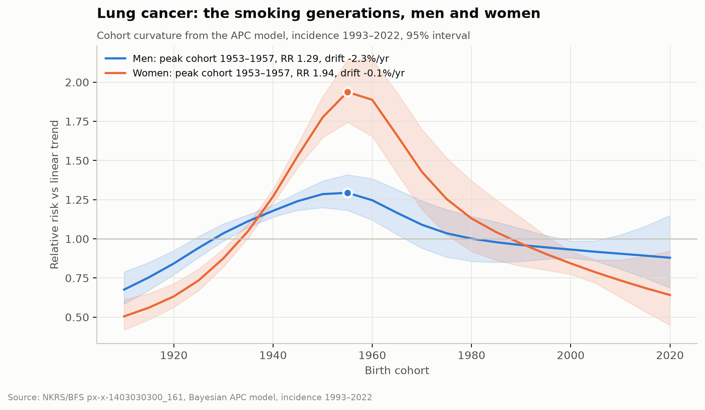
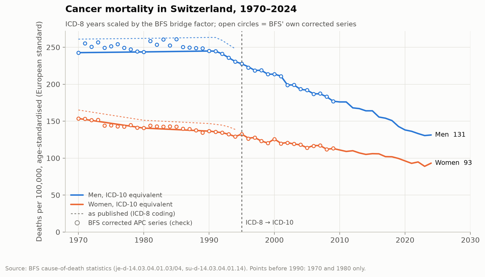
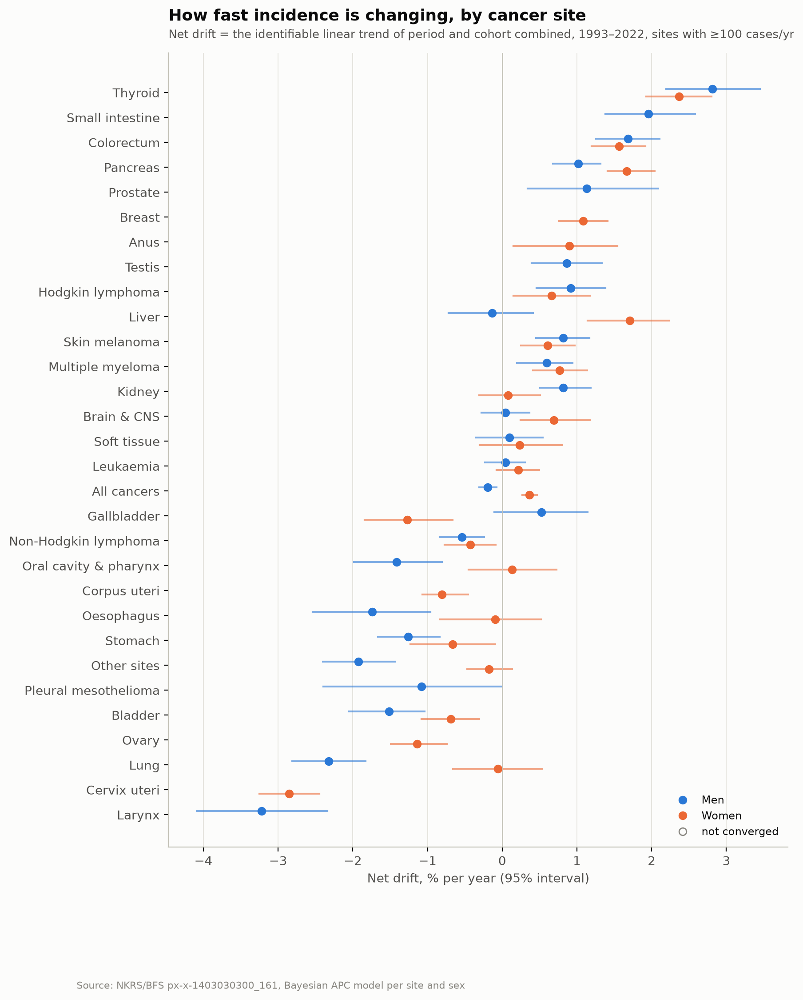
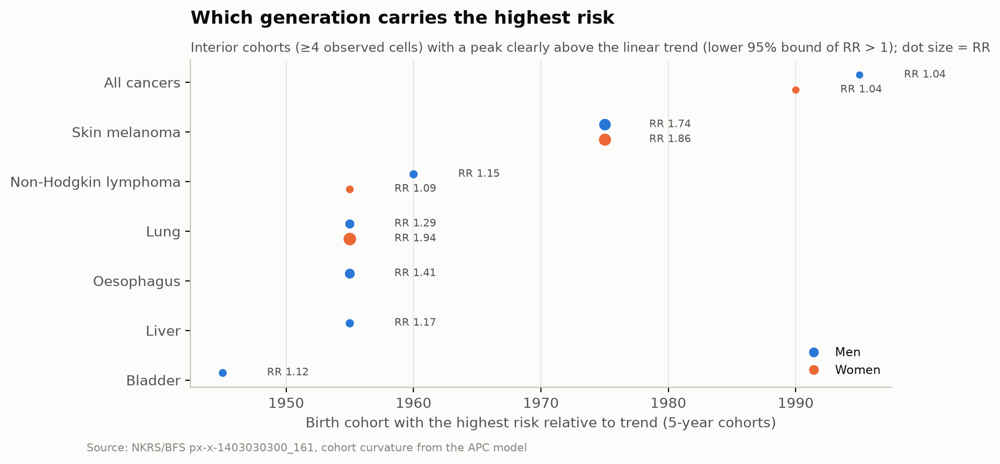
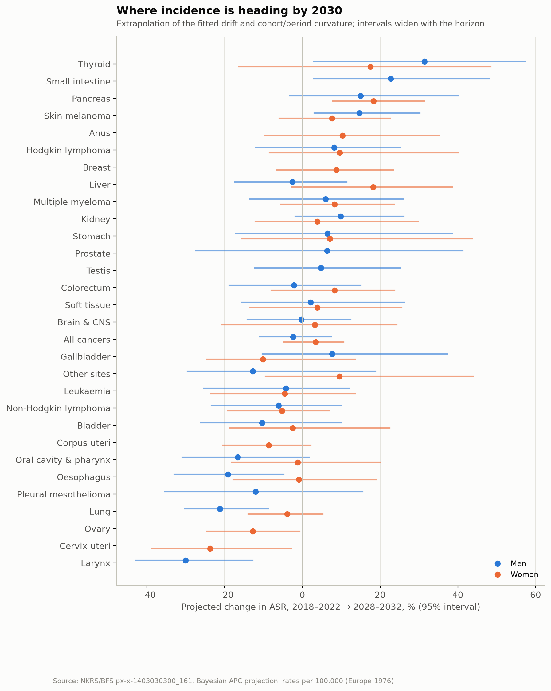
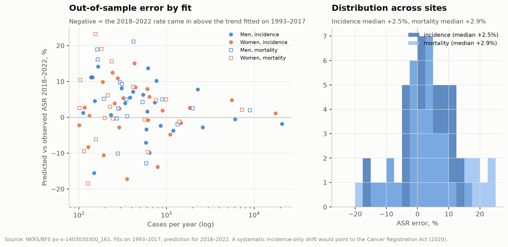
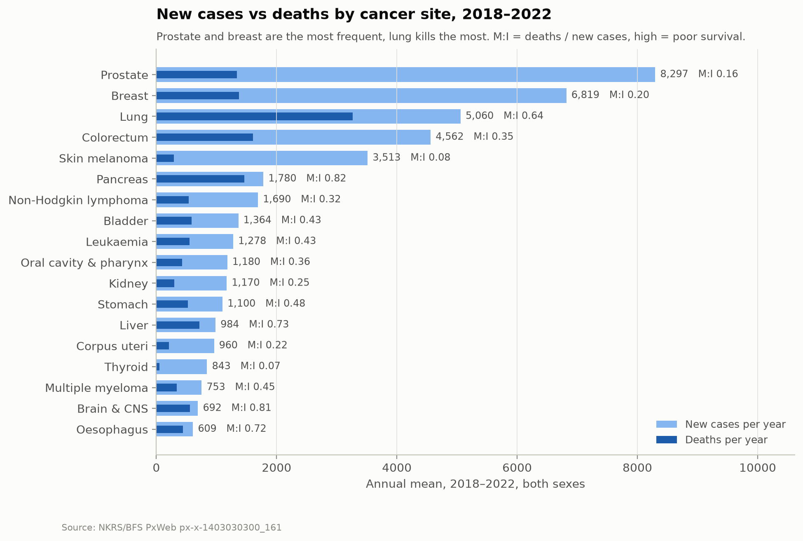

# cancer-ch

**Thirty years of cancer in Switzerland, rebuilt from official public data and decomposed into age, period and generation.**




*The generations that carry lung cancer. Cohort relative risk versus trend from the age-period-cohort model, NKRS incidence 1993–2022. Women born 1953–1957 carry almost twice the risk of their trend line; the female rise of the last 30 years is a cohort effect, not a secular trend.*

## Highlights

| | |
|---|---|
| **Scope** | All 36 cancer sites × sex × incidence and mortality, Switzerland and two language regions, 1993–2022 (incidence) and 1970–2024 (mortality) |
| **Model** | Bayesian age-period-cohort model (NumPyro / NUTS) per site and sex: 214 fits, all 214 pass R-hat < 1.01, ESS ≥ 400 and BFMI ≥ 0.3, every one validated out-of-sample |
| **Headline** | Cancer mortality fell 46% (men) and 39% (women) since the 1980s; incidence is flat (−0.2% / +0.4% per year) |
| **Lung** | Men −2.3%/yr; women no trend at all, their rise is a pure cohort effect peaking for women born 1953–57 and now turning down |
| **Generations** | The 1950s cohort peaks at every tobacco- and alcohol-related site at once; melanoma has its own generation, born in the 1970s |
| **By 2030** | Thyroid +17–31%, pancreas +15–18%, melanoma +8–15%; larynx −30%, cervix −24%, lung (men) −21% |
| **Data quality** | Our crude and age-standardised rates reproduce the registry's to the decimal; the ICD-8 → ICD-10 coding break is bridged with factors confirmed by two independent methods |
| **No cantons, no causation** | The BFS API has no cantonal incidence (cantonal registries publish it as PDF reports, most only since 2020); correlating aggregated rates with pollution or smoking would be an ecological fallacy, so this project does not |

## Contents

- [What this is](#what-this-is)
- [Results](#results)
  - [Mortality since 1970](#mortality-since-1970)
  - [Trends by site](#trends-by-site)
  - [Lung cancer and the smoking generations](#lung-cancer-and-the-smoking-generations)
  - [Which generation carries the highest risk](#which-generation-carries-the-highest-risk)
  - [Projection to 2030](#projection-to-2030)
  - [Out-of-sample check](#out-of-sample-check)
  - [Frequency is not lethality](#frequency-is-not-lethality)
- [Data](#data)
- [Method](#method)
- [Validation](#validation)
- [Pipeline](#pipeline)
- [Running it](#running-it)
- [GPU vs CPU](#gpu-vs-cpu)
- [Limitations](#limitations)
- [Future work](#future-work)
- [Documentation](#documentation)
- [Sources and licence](#sources-and-licence)

## What this is

A research pipeline that pulls every public cancer table the Swiss Federal Statistical Office
(BFS) and the National Agency for Cancer Registration (NKRS) publish, proves the numbers
against the publisher at every step, and fits a Bayesian age-period-cohort (APC) model to
separate three things that trend charts mix up:

- **age**: risk rises with age;
- **period**: something changes for everybody at once (screening, treatment, coding rules);
- **cohort**: a generation carries its exposure with it (smoking is the textbook case).

Everything here is reproducible from the public APIs: no microdata, no manual downloads.

## Results

All rates per 100,000, age-standardised to the European standard population (1976).

### Mortality since 1970



*Age-standardised cancer mortality, men and women. Solid: ICD-10 equivalent series (the
1970–1994 ICD-8 years scaled by the bridge factor). Dotted: as published. Circles: BFS' own
corrected series, an independent check that overlaps ours in every year.*

Men peaked at about 260 per 100,000 in the mid-1980s and stand at 131 in 2024 (−46% since
1990); women went from 154 in 1970 to 93 (−39%).

### Trends by site



*Net drift of incidence 1993–2022: the identifiable linear trend of period and cohort combined,
with 95% intervals, sites with ≥100 cases per year.*

Rising: thyroid (+2.8% men / +2.4% women per year), small intestine, colorectum (+1.7 / +1.6),
pancreas, prostate, breast. Falling: larynx (−3.2), cervix (−2.8), lung in men (−2.3),
oesophagus, bladder, stomach. Colorectal, breast and prostate incidence rise while their
mortality falls at −1.9, −2.5 and −3.0% per year: the signature of screening.

### Lung cancer and the smoking generations

See the hero figure above. Incidence drift is −2.3%/yr in men and −0.1%/yr in women;
mortality −3.9 and −2.1. The female rise from 18.8 to 32.2 per 100,000 is entirely a cohort
effect, peaking for women born 1953–1957 (RR 1.94 versus trend) and falling for every later
generation; the model projects female incidence to plateau and turn down. In men the 1950s
cohorts also sit above the trend (RR 1.29), on top of a steep decline.

### Which generation carries the highest risk



*Birth cohort with the highest relative risk versus trend, sites where the peak is clearly
above the trend line (lower 95% bound of RR > 1). Dot size = RR.*

### Projection to 2030



*Projected change in age-standardised incidence from 2018–2022 to 2028–2032, extrapolating
the fitted drift and curvatures. Intervals widen with the horizon and with small counts.*

### Out-of-sample check



*Every model refitted on 1993–2017 and asked to predict 2018–2022. Median error +2.5%
(incidence) and +2.9% (mortality): rates came in slightly below trend. There is no
incidence-only jump that the 2020 Cancer Registration Act would have produced.*

### Frequency is not lethality



*New cases and deaths per year, 2018–2022. Prostate and breast are the most frequent; lung
kills the most. M:I = deaths / new cases, a crude survival proxy.*

## Data

| Source | ID | Grid | Years |
|---|---|---|---|
| Cancer incidence and mortality, NKRS | PxWeb `px-x-1403030300_161` | region × site × sex × 5-year period × 5-year age | 1993–2022 |
| Crude and standardised rates, NKRS | `px-x-1403030300_162` | region × site × sex × period | 1993–2022 |
| Deaths by cause, BFS | `je-d-14.03.04.01.01–04` | cause × sex (× broad age) | 1970–2024 |
| Mortality APC tables, BFS | `su-d-14.03.04.01.11–20` | period × age, with ICD-corrected series | 1970–2009 |
| Population, BFS STATPOP / balance | `px-x-0102010000_102`, `px-x-0102020000_104` | canton × sex × single age | 1981–2025 |

What the BFS API does **not** have: cancer incidence by canton, annual incidence by site (only
5-year means), fine age groups in annual mortality. Cantonal incidence does exist outside the
API: the cantonal registries publish annual reports with site × sex tables of counts and
European-standard rates (Zürich since 1980, Zug since 2011, most other cantons only since the
2020 Cancer Registration Act), as PDF. See [Future work](#future-work).

## Method

Per site × sex × indicator, on the 18 age × 6 period grid (23 birth cohorts):

```
y_ap ~ Poisson(PY_ap · exp(η_ap))
η_ap = α_a + δ·(p − p̄) + β_p + γ_c + ε_ap          c = p − a
```

- α: age curve, free vector; δ: **net drift**, the identifiable linear trend;
- β, γ: second-order random walks with the linear trend removed, so only **curvature** is
  reported. The split of a linear trend between period and cohort is not identifiable from APC
  data (Holford 1983; Riebler & Held 2017), and the model does not pretend otherwise;
- ε: extra-Poisson variation. NUTS, 4 chains, 2000 warm-up + 2000 draws, target acceptance
  0.99. A fit counts as converged only if it has ≤ 10 divergences, R-hat < 1.01 on every
  parameter, bulk and tail ESS ≥ 400 and BFMI ≥ 0.3 on every chain; all 214 do (one holdout
  fit needed a second seed, recorded in its `summary.json`). Projections extrapolate the
  random walks.

Before modelling, mortality 1970–1994 is converted to an ICD-10 equivalent with per-cause
bridge factors (colorectal 0.85, prostate 0.86, breast 0.89, all cancers 0.93, lung 0.96)
estimated two independent ways that agree to 0.001.

## Validation

| Check | Result |
|---|---|
| Crude rate vs NKRS, Switzerland, all cancers, 2018–22 | 557.0 / 617.9 / 497.1 (both / men / women): identical |
| ASR (Europe 1976) vs NKRS | 384.6 / 440.6 / 339.2: identical |
| 419 cells with ≥100 cases/yr | crude within 1%: 99.8%; ASR within 2%: 100% |
| Two independent BFS cause-of-death tables, 1990–2024 | identical for every cancer row |
| Cause-of-death vs cancer-registry mortality ASR | all cancers −0.4%, lung −0.3%, stomach +0.4%, prostate −0.7% |
| Model on synthetic data with known drift −1.5%/yr and a cohort bump at 1968 | recovers −1.48%/yr (−1.60…−1.35) and 1968 |
| Holdout 2018–2022, 87 fits with ≥100 cases/yr | median error +2.5% incidence, +2.9% mortality |
| Unit tests (`pytest`, run in CI) | population convention, ESP1976 and ASR, RW2 normalisation, detrending, model forward pass, convergence gate |

## Pipeline

```
s00_audit             DAM catalogue + PxWeb discovery → what grid the public data really has
s01_ingest            PxWeb cubes (JSON-stat2) → Parquet; BFS tables → raw/
s02_parse_mortality   cause-of-death workbooks → annual series, cross-checked
s03_parse_apc         BFS APC tables → ICD-8 → ICD-10 bridge factors
s04_harmonise         mid-year population, language regions, rates validated against NKRS
s06_apc               Bayesian APC per site × sex × indicator, full + holdout
s07_report            index of all fits, cohort peaks, sweep figures
```

Every stage is idempotent, writes its checks to `data/audit/sNN_checks.md` and exits non-zero
on a hard failure.

## Running it

```bash
git clone https://github.com/maltsev-andrey/cancer-ch.git && cd cancer-ch
conda create -n cancer-ch python=3.11 -y && conda activate cancer-ch
conda install -c conda-forge pandas pyarrow pyyaml openpyxl python-calamine requests tabulate \
      matplotlib numpyro jax arviz h5netcdf h5py -y

python pipeline/s00_audit.py            # ~5 min, downloads ~600 BFS tables
python pipeline/s01_ingest.py --plan && python pipeline/s01_ingest.py
python pipeline/s02_parse_mortality.py
python pipeline/s03_parse_apc.py
python pipeline/s04_harmonise.py
pytest                                  # 21 unit tests, seconds; pytest -m slow adds synthetic recovery
python pipeline/s06_apc.py --site "Lunge, Bronchien, Luftröhre" --sex F --future 2   # one fit, ~25 s on 4 cores
python pipeline/s06_apc.py --list       # all 107 qualifying fits; run them with --index N
python pipeline/s07_report.py
```

Data lives in `../data` next to the repository (or wherever `CANCER_CH_DATA` points); nothing
but code, documentation and figures is committed. BFS PxWeb rejects queries above ~50k cells
with a bare 403; the ingest splits queries automatically.

## GPU vs CPU

The same fit took 694 s on a Tesla P100 and about 20 s on four CPU cores: a model with 108
data cells gives NUTS nothing to parallelise, and kernel-launch overhead dominates. The sweep
ran on a 20-core CPU host, four fits in parallel, 214 fits in about 90 minutes. A batched
model fitting all sites in one vectorised program is the way to make the GPU pay off, and is
on the list.

## Limitations

- **No cantons.** Switzerland and two language regions are all the BFS API supports; cantonal
  registry reports exist but are PDF tables with uneven depth (see Future work).
- **Five-year periods** for incidence: the model sees six points in time.
- **Identifiability.** Only drift and curvatures are reported; a "peak cohort" is a generation
  above the trend line, not necessarily the one with the highest absolute rate.
- **Projections** assume no new screening programme, coding change or exposure.
- **Structural breaks**: ICD-8 → ICD-10 (1995, bridged), the Cancer Registration Act (2020, no
  measurable incidence jump) and COVID-19 (2020–21, likely behind the small holdout shift).
- This is a statistical description of registry data, not medical advice and not a causal study.

## Future work

Version 1.1 is about checkability, not more models. Done: unit tests for the population
convention, ESP1976 and ASR, the RW2 + detrend parameterisation and synthetic-data recovery,
run in CI; full MCMC diagnostics (ESS bulk and tail, BFMI, tree depth) with the gate
tightened to R-hat < 1.01. Tightening it sent 48 of 214 fits back; 2000 draws at target
acceptance 0.99 brought every one through without touching the model. Open, tracked as
GitHub issues:

1. **Rolling-origin backtesting**: refit with training ending 2007, 2012 and 2017, score the
   one- and two-period-ahead projections, not just the single 2018–2022 holdout.
2. **Prior sensitivity** on ten key sites: drift, random-walk and extra-Poisson scales
   varied ×0.3 and ×3.
3. **`research_findings.md`** separating what is observed in the data, what the model
   estimates, and what is projected or hypothesised.
4. **Cantonal mortality.** Cause-of-death by canton is in the BFS API for 1990–2024 and
   supports a BYM2 spatial model without touching PDFs. Cantonal incidence from the registry
   reports (Zürich/Zug/Schaffhausen/Schwyz and the others) would come after, once
   comparability (C44, in situ, standard population) is checked.

## Documentation

[`docs/research_findings.md`](docs/research_findings.md) lists every finding with its evidence
class: observed in the data, estimated by the model, projected, hypothesised, or rejected, each
with the fit or stage that reproduces it.

`docs/wiki/` is a ten-chapter write-up: data sources, audit, ingest, mortality parsing, the ICD
bridge, harmonisation, the model, results, and a chapter of lessons learned about the BFS APIs
and file formats (the 1 January population stock tabulated by end-of-year age is the one to
read before touching Swiss demographic data).

## Sources and licence

Data: Swiss Federal Statistical Office (BFS), National Agency for Cancer Registration (NKRS)
and STATPOP, via `dam-api.bfs.admin.ch` and `pxweb.bfs.admin.ch`, used under the BFS open
data terms (attribution). Methods: Holford (1983), Riebler & Held (2017), Carstensen (2007).

Code and figures: MIT licence. Figures may be reused with attribution to this repository and
to BFS/NKRS as the data source.
