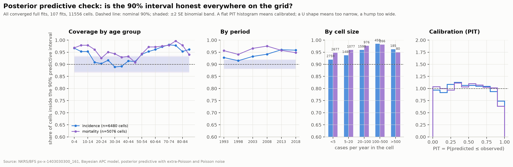
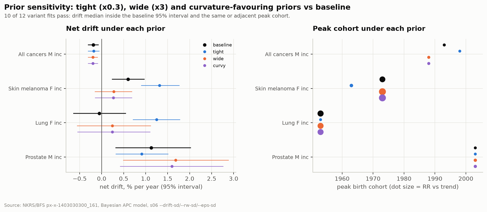

# 07 · Age-period-cohort model (s06)

`pipeline/s06_apc.py` fits one Bayesian APC model per site × sex × indicator on the NKRS grid:
18 five-year age groups × 6 five-year periods (1993–2022), 23 birth cohorts. 107 fits qualify
(≥30 cases per year), each run twice: full (with projection) and holdout.

## Model

```
y_ap ~ Poisson(PY_ap · exp(η_ap))
η_ap = α_a + δ·(p − p̄) + β_p + γ_c + ε_ap          c = p − a
```

| Term | Prior | Meaning |
|---|---|---|
| α_a | free vector, N(−8, 5) | age curve (pinned by the data, no hyperparameter) |
| δ | N(0, 0.5) | **net drift**: the identifiable linear trend of period and cohort combined |
| β_p | RW2, linear trend removed | period curvature only |
| γ_c | RW2, linear trend removed | cohort curvature only |
| ε_ap | N(0, s_ε) | extra-Poisson variation |

The split of a linear trend between period and cohort is not identifiable from any APC data
(Holford 1983; Riebler & Held 2017). The model does not pretend otherwise: it reports drift,
curvatures and the age curve, which are identifiable, and shows cohort effects as **relative
risk versus the linear trend**. A cohort "peak" is therefore a generation that lies above the
trend line, not necessarily the generation with the highest absolute rate.

NUTS (NumPyro), 4 chains, 2000 warm-up + 2000 samples, `target_accept` 0.99. Every fit is
checked on ≤ 10 divergences, r̂ < 1.01 for every parameter, bulk and tail ESS ≥ 400 and
BFMI ≥ 0.3 on every chain (`diagnostics()` in s06, written to `summary.json`). Result:
**214 of 214 fits converged** in one sweep with seed 1; one holdout fit (breast, women,
r̂ 1.015) was rerun with seed 2, which is recorded in its summary.

Version 1.0 used 1000 + 1000 draws at `target_accept` 0.9 with a gate of r̂ < 1.05. Moving to
the stricter gate sent 48 fits back: about a third on r̂ alone (1.010–1.015, an estimation
noise at 1000 draws), a third on tail ESS of the random-walk scales, and a third on
divergences, which clustered on the highest-count sites (prostate, breast, colorectum, liver).
That pattern suggested a non-centred funnel, but it was not one: raising `target_accept` from
0.95 to 0.99 removed the divergences completely, which a true funnel does not do. The step
size was simply too large for the sharply curved posterior of a site with 6000 cases a year.
No estimate moved by more than 0.1 %/yr between the two sweeps.

## What it took to make it sample

| Problem | Symptom | Fix |
|---|---|---|
| RW2 built as a double cumsum of N(0,1) | amplitude ~ n^1.5; one chain ran to 10^23 | normalise by n^1.5 so the scale parameter is the curve's SD |
| RW2 on the age curve | all-cancers age curve spans 6 log units; second differences far outside their N(0,1) prior; r̂ 1.4 | age as a free vector (centred); the data pin 18 parameters with 6 periods each |
| Non-centred RW1 on age | funnel between s_age and the increments with strong data; r̂ 2.1 on synthetic data | same fix: centred, no hyperparameter |
| Predictive interval without noise | 39% holdout coverage of a 90% interval | add ε and Poisson noise to the posterior predictive |
| Cohort peak at the grid edge | "peak cohort 2020, RR 2.7" (one observed cell) | search peaks only among cohorts with ≥ 4 observed cells |

Every change was first checked on a synthetic grid with a known drift (−1.5%/yr) and a known
cohort bump (1968): the model recovers −1.48%/yr (−1.60…−1.35) and the bump at 1968.

## Validation

- **Holdout:** fit on 1993–2017, predict 2018–2022. Over 87 fits with ≥100 cases per
  year the median error is **+2.4% for incidence and +2.7% for mortality**: the 2018–2022 rates
  came in slightly *below* the extrapolated trend for both indicators.
- **Rolling-origin backtest** (`s06 --train-until 2007|2012|2017`, report in `s08_backtest`):
  the same fit repeated with the training window ending in 2007 (three periods), 2012 (four)
  and 2017 (five), every later period scored at horizon 1, 2, 3. 321 fits, 320 converged (three
  of them at seed 2); female lung incidence trained to 2012 keeps 34–38 divergences at both
  seeds and is excluded: four periods cannot separate the 1950s cohort from a drift.

  | Target period | Incidence, origin 2007 / 2012 / 2017 | Mortality |
  |---|---|---|
  | 2008–2012 | −0.3 | −1.3 |
  | 2013–2017 | +0.0 / −1.6 | −1.9 / −2.5 |
  | 2018–2022 | −0.2 / +0.7 / **+2.4** | +2.6 / +2.0 / **+2.7** |

  Medians of the ASR error (predicted / observed − 1) over fits with ≥100 cases per year,
  n = 37–50 per cell. Two things follow. The positive shift is a property of the period
  2018–2022, not of the model: the same models predict 2008–2017 with no bias or a slightly
  negative one. And error grows with horizon in a regular way: median absolute deviation
  4–6% one period ahead, 7–8% at two, 12–15% at three; the share of fits within ±10% falls
  from 74–86% to 38–42%. Sites with a strong cohort effect are the worst at three periods:
  trained to 2007, female lung incidence reads the cohort rise as a +2.4%/yr drift and
  overshoots 2018–2022 by 9%, because three periods cannot separate a trend from a cohort
  passing through the ages of risk.
- Two implementation details of the backtest. In a backtest the period curvature is
  detrended on the *observed* periods only, so the held-out periods are a pure RW2
  extrapolation, exactly as in a projection; `--detrend-all` restores the earlier behaviour
  (detrend over all six periods, held-out one included) for A/B purposes. On the v1.1
  settings the two give the same holdout error to 0.2% and the same diagnostics. The second
  detail is a lesson rather than a feature: the first backtest run silently went out at the
  v1.0 sampler defaults because a patched `s06_apc.py` was copied over the server's version,
  and 72 of 321 fits failed the gate. The sanitize gate now asserts the sampler defaults.
- This also answers the registration-act question. If the Cancer Registration Act (2020) had
  inflated registered incidence, incidence would sit systematically *above* trend while
  mortality would not. It does not: 38% of incidence fits are below trend, 62% above, and
  mortality moves the same way. Lung cancer in men (−4%, observed above trend) is the
  exception, not the rule. The more likely reading of the small positive medians is the
  COVID-19 dip in diagnoses in 2020–2021 and a mortality decline that keeps accelerating.

## Posterior predictive check by age (s09)



The holdout checks the interval in one period; this checks it in every cell of every full fit
(107 fits, 11,556 cells). Coverage of the 90% predictive interval is 0.94 for incidence and
0.96 for mortality; by age group it runs 0.89–0.98 with no group below the ±2 SE binomial band,
and 85+ sits at 0.96 / 0.94, so the free age vector is not overfitting the oldest cells. The
lowest coverage is at ages 30–39, exactly nominal. The PIT histogram is close to flat (KS
0.03–0.04) with a deficit in the top decile, and the z-residuals have sd 0.90 / 0.82: the
extra-Poisson term gives the interval a little more width than the data need. For projections
that is the right side to err on. Part of the excess is also in-sample optimism, since the
posterior has seen these cells.

## Prior sensitivity (s10)



Four fits (female lung and melanoma incidence, prostate, all cancers in men) refitted under
three alternative priors: `tight` (all scales ×0.3), `wide` (×3) and `curvy` (drift ×0.3, RW
×3, which pushes variation from the drift into the curvatures). `scripts/run_prior_sensitivity.sh`
writes them to `<slug>_prior-<tag>` directories and a separate `index_prior.parquet`, so the main
sweep is untouched.

10 of 12 pass (drift median inside the baseline 95% interval, same or adjacent peak cohort).
All-cancer drift moves by 0.02 %/yr at most. Under `wide` and `curvy`, lung and melanoma keep
their peak cohorts and RR within 0.1–0.3 of baseline. The two failures are both `tight` on the
two cohort-driven sites: with the RW scale prior at 0.15 the cohort RR collapses to 1.0 (lung)
and 1.2 (melanoma) and the drift jumps to +1.25 and +1.31 %/yr. A prior that forbids
curvature does not remove the signal, it relabels it as a trend, which is the same
drift-versus-cohort trade-off the backtest shows for a three-period window. The cohort peaks are
therefore a property of the data, not of the prior. Prostate is the one site whose projection
is prior-sensitive: the drift stays inside its interval but the 2030 ASR moves from 143 to
151–156, consistent with the wide interval it carries in the projection figure.

## GPU vs CPU

The same lung-cancer fit took **694 s on the Tesla P100** (4 chains × 3000 draws) and
**~20 s on 4 CPU cores** (4 × 2000 draws): per draw the GPU is about 20× slower. A model
with 108 data cells and ~70 parameters gives NUTS nothing to parallelise within a step, and
kernel-launch overhead dominates. The sweep therefore ran on a 20-core CPU host with 4 fits
in parallel (16 cores, 4.5 GB RAM): 214 fits in about 45 minutes. A batched model that fits
all 107 sites in one vectorised program is the way to make the GPU useful here, and is left
for a later iteration.
